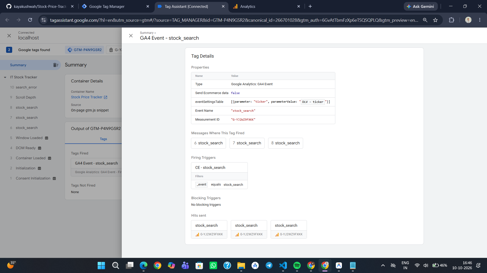
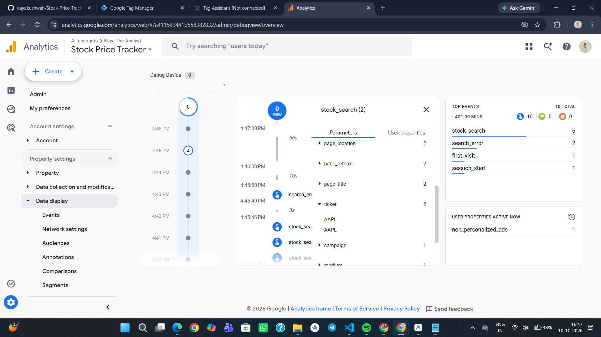

# 📈 IT Stock Tracker

A full-stack real-time stock market dashboard focused on the **Indian IT sector** — built with React, Node.js, MongoDB, and Alpha Vantage. Includes complete **GA4 + GTM** event analytics to track user behaviour at the ticker level.

> Built as part of the Tatvic Analytics internship assessment.

---

## 🖥️ App Screenshots

> _(Add your screenshots here after taking them — see the Testing section below)_

| Dashboard | Stock Detail | Market Trends |
|-----------|-------------|---------------|
| `dashboard.png` | `stock_detail.png` | `market_trends.png` |

---

## ✨ Features

- 🔴 **Real-time prices** for top 9 IT stocks (TCS, Infosys, Wipro, HCL, and more)
- 📊 **Interactive charts** — 1D / 1W / 1M / 3M / 1Y price history
- ⭐ **Watchlist** — pin stocks for side-by-side chart comparison
- 💼 **Holdings tracker** — manage your portfolio
- 🌐 **Market Trends** — sector heatmap, breadth indicators, fear/greed index
- 🔍 **Global search** — search any symbol via Alpha Vantage API
- 🌙 Dark mode glassmorphism UI
- 📬 **Price alert emails** via Nodemailer
- 📡 **GA4 + GTM event tracking** (stock searches, error types)

---

## 🛠️ Tech Stack

| Layer | Technology |
|-------|-----------|
| Frontend | React 18, Vite, Vanilla CSS |
| Backend | Node.js, Express |
| Database | MongoDB Atlas (Mongoose) |
| Stock Data | Alpha Vantage REST API |
| Auth | JWT + bcrypt |
| Email | Nodemailer (Gmail SMTP) |
| Analytics | Google Analytics 4 (G-YJ2WZ9FXKK) via GTM (GTM-P4N9GSR2) |
| Deployment | Render (backend) + Vercel (frontend) |

---

## ⚡ Quick Start

### Prerequisites
- Node.js >= 18
- MongoDB Atlas account (free tier works)
- Alpha Vantage API key — get one free at https://www.alphavantage.co/support/#api-key

### 1. Clone & install

```bash
git clone https://github.com/kayakushwah/Stock-Price-Tracker.git
cd Stock-Price-Tracker/IT_Stock_Tracker

# Install server deps
cd server && npm install

# Install client deps
cd ../client && npm install
```

### 2. Configure environment variables

**`server/.env`** (never commit this file):
```env
PORT=5001
MONGO_URI=mongodb+srv://<user>:<password>@cluster.mongodb.net/StockPriceTracker
JWT_SECRET=your_strong_jwt_secret
ALPHA_VANTAGE_API_KEY=your_alpha_vantage_key
EMAIL_SERVICE=gmail
EMAIL_USER=your-email@gmail.com
EMAIL_PASS=your-app-password
NODE_ENV=development
FRONTEND_URL=http://localhost:5173
```

> WARNING: Never add ALPHA_VANTAGE_API_KEY to the client .env or prefix it with VITE_ — it would be bundled into the public JavaScript.

### 3. Run locally

```bash
# Terminal 1 — backend
cd server && npm start        # runs on :5001

# Terminal 2 — frontend
cd client && npm run dev      # runs on :5173
```

Open http://localhost:5173

---

## 📡 Analytics — GA4 + GTM

### Tracking Plan

| Event | Parameters | When it fires |
|-------|-----------|---------------|
| `stock_search` | `ticker` | User clicks a search result or navigates to a stock detail page |
| `search_error` | `error_type` | Search or stock fetch fails |

#### `error_type` values

| Value | Meaning |
|-------|---------|
| `rate_limit` | Alpha Vantage API quota exceeded (free tier = 25 calls/day) |
| `invalid_symbol` | Symbol not found / empty quote returned |
| `network_error` | Unexpected network or server failure |

### How events flow

```
User clicks search result
        |
        v
Sidebar.jsx -> trackStockSearch(symbol)
        |
        v
window.dataLayer.push({ event: 'stock_search', ticker: 'AAPL' })
        |
        v
GTM Container (GTM-P4N9GSR2) picks it up
        |
        v
GA4 Event Tag fires -> GA4 Property (G-YJ2WZ9FXKK)
```

### GTM Setup Reference

| Item | Name | Type | Config |
|------|------|------|--------|
| Variable | `DLV - ticker` | Data Layer Variable | `ticker` |
| Variable | `DLV - error_type` | Data Layer Variable | `error_type` |
| Trigger | `CE - stock_search` | Custom Event | Event name: `stock_search` |
| Trigger | `CE - search_error` | Custom Event | Event name: `search_error` |
| Tag | `GA4 Config` | Google Tag | Measurement ID: `G-YJ2WZ9FXKK`, Trigger: Initialization – All Pages |
| Tag | `GA4 - stock_search` | GA4 Event | Event: `stock_search`, Param `ticker` = `{{DLV - ticker}}` |
| Tag | `GA4 - search_error` | GA4 Event | Event: `search_error`, Param `error_type` = `{{DLV - error_type}}` |

### GA4 + GTM Screenshots

**1. GTM Tag Firing (Tag Assistant)**


**2. GA4 DebugView Timeline**


---

## 🚀 Deployment (Render)

### Backend (Render Web Service)

1. Go to render.com -> New -> Web Service
2. Connect your GitHub repo, set Root Directory to `IT_Stock_Tracker/server`
3. Build command: `npm install`
4. Start command: `node server.js`
5. Add Environment Variables in the Render dashboard (same as server/.env)
6. Copy the live URL (e.g. https://it-stock-tracker-api.onrender.com)

### Frontend (Vercel)

1. Go to vercel.com -> Import repo
2. Set Root Directory to `IT_Stock_Tracker/client`
3. Update `vite.config.js` proxy target to the Render URL for production

---

## 🔐 Security Notes

- `ALPHA_VANTAGE_API_KEY` lives **only** in `server/.env` — never exposed to the browser
- Both `.env` files are in `.gitignore` at root and client level
- JWT tokens expire and are cleared from `localStorage` on 401
- CORS origin list is explicit — wildcard `*` is not used

---

## 📁 Project Structure

```
IT_Stock_Tracker/
├── client/                  # React + Vite frontend
│   ├── src/
│   │   ├── components/      # Sidebar (search + events), StockCard, etc.
│   │   ├── pages/           # Dashboard, StockDetail, Watchlist, etc.
│   │   ├── lib/
│   │   │   └── analytics.js # GTM dataLayer helper
│   │   └── api/axios.js     # Axios instance with JWT interceptors
│   └── index.html           # GTM snippets injected here
└── server/                  # Express backend
    ├── controllers/
    │   └── stockController.js # Alpha Vantage integration + error typing
    ├── routes/stockRoutes.js
    ├── models/
    └── server.js
```

---

## 📜 License

MIT
